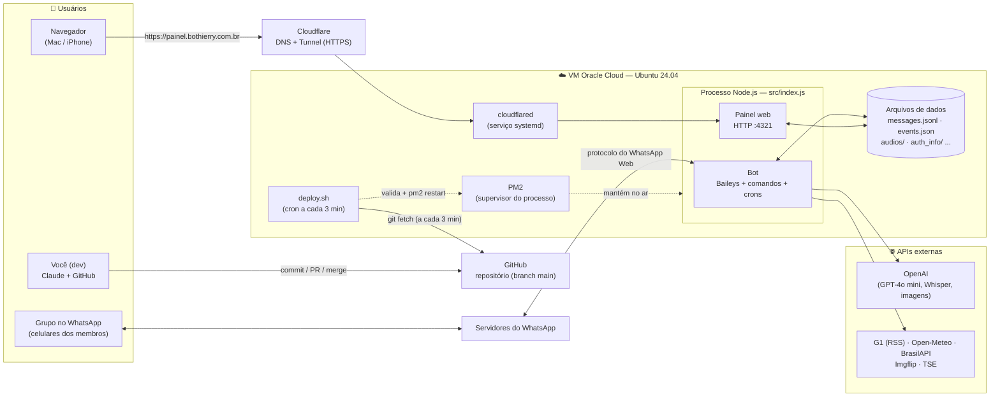
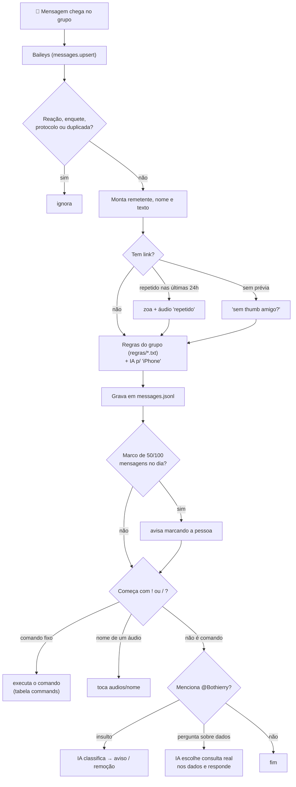
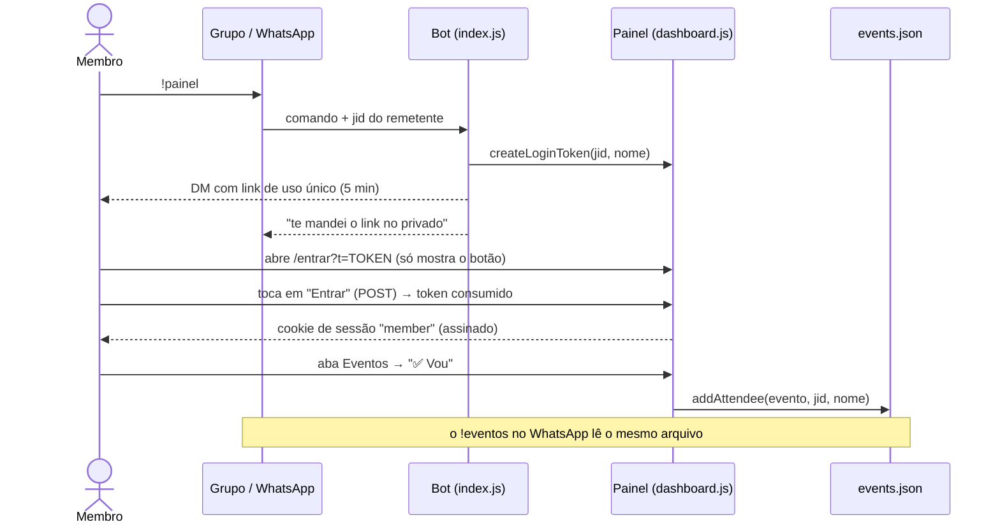
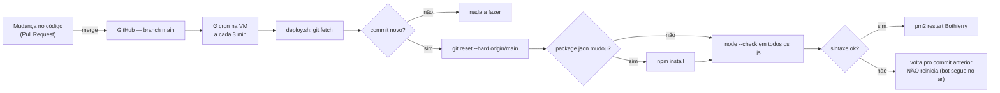

# Bothierry — bot de WhatsApp do grupo

Bot que conecta no WhatsApp (via [Baileys](https://github.com/WhiskeySockets/Baileys)), escuta as mensagens do grupo e grava localmente quem enviou o quê e quando. Com isso ele conta mensagens por pessoa, gera ranking e resumo da conversa, fiscaliza regras do grupo, manda avisos automáticos (bom dia, aniversários, propaganda) e mantém um **painel web** com gráficos, eventos e administração.

Não usa a API oficial da Meta: conecta como se fosse o "WhatsApp Web" de um número próprio, então não precisa de aprovação nem custa nada. Em troca, o número do bot precisa continuar logado (igual o WhatsApp Web normal).

O armazenamento é um conjunto de arquivos de texto (`messages.jsonl` etc.) em vez de um banco de dados — de propósito, pra não depender de nenhum pacote com código nativo e caber numa VM pequena.

**Índice:** [Arquitetura](#1-arquitetura) · [Hospedagem](#2-onde-e-como-roda-hospedagem) · [Fluxos](#3-fluxos) · [Módulos](#4-módulos-do-código) · [Dados](#5-dados-e-armazenamento) · [Tarefas agendadas](#6-tarefas-agendadas) · [Integrações](#7-integrações-externas) · [Configuração](#8-configuração-env) · [Painel](#9-painel-web) · [Comandos](#10-comandos-do-bot) · [Automações](#11-automações-sem-comando) · [Operação](#12-operação-no-dia-a-dia) · [Segurança](#13-segurança-e-privacidade) · [Local](#14-rodando-localmente)

---

## 1. Arquitetura

Visão geral de quem fala com quem:



**Em uma frase:** um único processo Node.js (gerenciado pelo PM2) numa VM gratuita da Oracle Cloud faz tudo — fala com o WhatsApp, executa os comandos, roda as tarefas agendadas e serve o painel web. O Cloudflare Tunnel expõe o painel em HTTPS, e o GitHub é a fonte do código (a VM se atualiza sozinha a partir da `main`).

---

## 2. Onde e como roda (hospedagem)

| Peça | O que é | Detalhe |
| --- | --- | --- |
| **Servidor** | VM na **Oracle Cloud** (tier *Always Free*) | Shape `VM.Standard.E2.1.Micro`, ~1 GB de RAM, 45 GB de disco, **swap de 2 GB** como rede de segurança |
| **Sistema** | Ubuntu 24.04 LTS | usuário `ubuntu`, projeto em `/home/ubuntu/bothierry` |
| **Runtime** | Node.js 24 (NodeSource) | módulos ES (`"type": "module"`) |
| **Supervisor** | **PM2** (processo `Bothierry`) | `ecosystem.config.cjs`: carrega o `.env`, timestamp nos logs, fuso `America/Sao_Paulo`, reinício automático se a memória passar de 750 MB, sobe sozinho no boot (`pm2 startup` + `pm2 save`) |
| **HTTPS do painel** | **Cloudflare Tunnel** nomeado | serviço `systemd` `cloudflared` (`/etc/cloudflared/config.yml`), separado do bot; aponta `painel.bothierry.com.br` → `localhost:4321` |
| **Domínio / DNS** | `bothierry.com.br` registrado na **GoDaddy**, DNS na **Cloudflare** | |
| **Código** | **GitHub** — `jppaivasilva/bothierry` (público) | branch `main` = o que está no ar |
| **Deploy** | `deploy.sh` no **cron da VM** (a cada 3 min) | veja [3.3](#33-deploy-automático) |
| **IA** | **OpenAI** | chave no `.env` da VM |

**Firewall:** além da porta 22 (SSH), a 4321 foi liberada em duas camadas (iptables da VM e Security List da Oracle) — hoje o acesso normal ao painel é pelo túnel HTTPS.

**Recursos:** a RAM da VM fica em ~80–90% de uso. É o limite do hardware gratuito (1 GB), não vazamento do código — por isso o histórico fica em arquivos lidos sob demanda e o Baileys roda com `syncFullHistory: false`.

---

## 3. Fluxos

### 3.1. O caminho de uma mensagem do grupo



### 3.2. Login no painel e presença em eventos (`!painel`)



Há três papéis no painel: **viewer** (login comum), **member** (entrou pelo link do `!painel`, pode marcar presença) e **admin** (usuário `root`, vê também apagar áudio, reiniciar o bot e logs). Veja a [seção 9](#9-painel-web).

### 3.3. Deploy automático



---

## 4. Módulos do código

Tudo em `src/` (JavaScript, módulos ES):

| Arquivo | Responsabilidade |
| --- | --- |
| `index.js` | **Núcleo**: conecta no WhatsApp (Baileys), recebe mensagens, tabela de comandos, detectores automáticos, todos os crons, mensagens agendadas |
| `dashboard.js` | Servidor HTTP do painel: login/sessões, papéis (viewer/member/admin), rotas `/api/*`, página única (HTML+CSS+JS embutidos) |
| `db.js` | Armazenamento das mensagens: grava, consulta (ranking, tendência, mapa de calor), arquiva antigas, descobre o **grupo principal** |
| `metrics.js` | Métricas do painel: conexão, comandos mais usados, última execução de cada cron, CPU/memória/disco da VM |
| `events.js` | Eventos e presença (`events.json`) |
| `birthdays.js` | Aniversariantes e controle de renomear o grupo |
| `scheduled.js` | Mensagens agendadas pontuais (`scheduled_messages.json`) |
| `rules.js` | Regras do grupo (`regras/*.txt`) |
| `dataQuestions.js` | Perguntas sobre dados do grupo via `@Bothierry` + IA |
| `groupPhoto.js` | Foto do grupo/bot editada por IA |
| `avatars.js` | Cache de fotos de perfil dos membros |
| `displayNames.js` | Padroniza nomes na exibição (acento, maiúsculas, homônimos) |
| `weather.js` | Previsão do tempo (Open-Meteo) |
| `news.js` | Manchetes do G1 (RSS) |
| `elections.js` | Apuração do TSE (eleição 2026, já concluída) |
| `report.js` | Relatório pelo terminal (`npm run report`) |

Fora de `src/`: `deploy.sh` (deploy automático), `ecosystem.config.cjs` (PM2), `scripts/set-avatar.js` (associa foto a alguém na mão), `assets/` (foto-base do bot, imagens fixas, banner da propaganda).

**Grupo principal:** o código **não depende do nome do grupo** (que muda com frequência). O bot usa o único grupo em que está — ou, havendo vários, o mais ativo nos últimos 7 dias; o painel usa o grupo com mais mensagens na última semana (`getMainGroupJid()` em `db.js`).

---

## 5. Dados e armazenamento

Tudo em arquivos na pasta do projeto, **na VM** (a maioria está no `.gitignore` — dado pessoal ou segredo não vai pro GitHub):

| Arquivo / pasta | O que guarda | Versionado? |
| --- | --- | --- |
| `auth_info/` | **sessão do WhatsApp** (quem tem isso controla o número do bot) | não |
| `.env` | chaves e senhas (veja [seção 8](#8-configuração-env)) | não |
| `messages.jsonl` | mensagens dos últimos **14 dias** ("janela quente", uma linha JSON por mensagem, texto incluso) | não |
| `archive/messages-AAAA-MM.jsonl` | mensagens mais antigas, um arquivo por mês (arquiva ao iniciar e todo dia às 03h) | não |
| `metrics.jsonl` | métricas do painel, 30 dias de retenção | não |
| `events.json` | eventos, confirmados e ausentes | não |
| `birthdays.json`, `apelidos.txt` | aniversariantes e apelidos | não |
| `scheduled_messages.json` | mensagens agendadas pontuais | não |
| `audios/` | áudios tocáveis (`!nome`), `repetido.mp3` do aviso de link repetido | não |
| `regras/`, `regulamento.txt`, `megasena.txt` | regras e textos fixos | não |
| `avatars/`, `avatarbot/`, `*_state.json` | fotos em cache, fotos temáticas, estados internos | não |
| `assets/` | foto-base do bot, imagens fixas, banner da propaganda | **sim** |

Como o painel é gerado pelo próprio bot, ele lê esses mesmos arquivos (mensagens, eventos, áudios, aniversariantes) — não existe banco separado.

---

## 6. Tarefas agendadas

Todas dentro do processo do bot (`node-cron`, fuso `America/Sao_Paulo`, tolerância de 2 min pra execução atrasada). A última execução de cada uma aparece na aba **Sistema** do painel.

| Quando | Tarefa |
| --- | --- |
| a cada minuto | envia mensagens agendadas vencidas (`scheduled_messages.json`) |
| a cada 5 min | grava CPU/memória/disco da VM (`metrics.jsonl`) |
| a cada 10 min | apuração de eleição (só em dia de votação) |
| 00:01 | sincroniza o nome do grupo (reverte renomeações do dia anterior) |
| 03:00 | arquiva mensagens antigas e poda métricas |
| 03:30 | troca a foto do bot se o tema mudou; sincroniza fotos de perfil |
| 08:00 (seg–sex) | bom dia + feriado nacional + previsão do tempo |
| 08:00 (seg e qua) | atualiza a foto do grupo com a notícia do dia (via IA) |
| 09:00 | aviso de aniversariantes + renomeia o grupo |
| 18:00 (seg–sex) | ranking do expediente (08h–18h) |
| 18:05 (sexta) | ranking semanal |
| **22:30 (todo dia)** | **propaganda (#ad)**: banner + legenda (`AD_HOUR`/`AD_MINUTE`/`AD_DAYS` em `index.js`) |

Além disso, ao conectar o bot checa aniversário, nome do grupo, tema da foto e fotos de perfil (catch-up se ele ficou desligado na hora exata).

---

## 7. Integrações externas

| Serviço | Pra quê | Chave? |
| --- | --- | --- |
| **WhatsApp** (via Baileys) | receber/enviar mensagens, renomear grupo, fotos | sessão em `auth_info/` |
| **OpenAI** — `gpt-4o-mini` | `!resumo`, regra do iPhone, insultos ao bot, perguntas sobre dados, escolher o tema da foto do grupo a partir da notícia | `OPENAI_API_KEY` |
| **OpenAI** — `whisper-1` | `!transcrever` | `OPENAI_API_KEY` |
| **OpenAI** — `gpt-image-1` | edição da foto do grupo/bot (o item mais caro do bot) | `OPENAI_API_KEY` |
| **G1** (RSS) | `!news` e notícia da foto do grupo | não |
| **Open-Meteo** | previsão do tempo do bom dia | não |
| **BrasilAPI** | feriados nacionais | não |
| **Imgflip** | `!meme` (templates populares) | não |
| **TSE** | apuração das eleições | não |
| **Cloudflare** | túnel HTTPS e DNS do painel | conta Cloudflare |
| **Chart.js** (CDN jsDelivr) | gráficos do painel, carregado no navegador | não |

Sem `OPENAI_API_KEY`, os comandos de IA avisam que falta configurar, em vez de quebrar.

---

## 8. Configuração (`.env`)

Arquivo `.env` na raiz do projeto, **só na VM** (nunca no git). O PM2 o carrega na subida (`--env-file=.env`), então depois de mudar precisa `pm2 restart Bothierry`.

| Variável | Pra quê |
| --- | --- |
| `OPENAI_API_KEY` | chave da OpenAI (resumo, transcrição, IA, imagens) |
| `DASHBOARD_USER` / `DASHBOARD_PASS` | login comum do painel (perfil **viewer**). Se `DASHBOARD_PASS` ficar vazia, o painel fica **aberto sem login** |
| `ADMIN_USER` / `ADMIN_PASS` | login de **administrador** do painel (`ADMIN_USER` padrão: `root`). Sem `ADMIN_PASS`, ninguém entra como admin |
| `DEBUG=1` | loga cada mensagem recebida e detalhes internos |

`.env.example` mostra o formato. **Não coloque senhas reais no repositório nem neste README.**

---

## 9. Painel web

Endereço: **https://painel.bothierry.com.br** (túnel da Cloudflare até a porta 4321 da VM). Visual em estilo "Apple glass", funciona bem no celular.

**Papéis**

| Papel | Como entra | O que pode |
| --- | --- | --- |
| **viewer** | login comum (`DASHBOARD_USER`/`PASS`) | ver todas as abas |
| **member** | link de uso único do `!painel` (chega no privado do WhatsApp) | tudo do viewer + marcar **Vou / Não vou** nos eventos, identificado pelo WhatsApp |
| **admin** | usuário `root` + `ADMIN_PASS` | tudo + apagar áudios, reiniciar o bot, ver logs |

A sessão é um cookie assinado com HMAC (30 dias), com o papel dentro da assinatura — não dá pra trocar de papel nem de pessoa. Ações sensíveis são barradas **no servidor** (403), não só escondidas na tela. Limite de 10 tentativas de login por IP a cada 5 minutos.

**Abas**

- **Visão geral** — mensagens por hora do dia (com 👑 de quem mais falou em cada hora) e **ranking** (Expediente 08h–18h ou dia completo, com seletor de data).
- **Atividade** — tendência por pessoa (7/14/30 dias) e mapa de calor (dia da semana × hora).
- **Membros** — todos do grupo, **ordenados pelo ranking de hoje** (quem não falou fica por último), com busca; clicar abre os detalhes da pessoa (pódio, horário preferido, últimos 14 dias).
- **Comandos** — menu de todos os comandos, aniversariantes cadastrados e áudios salvos (o admin vê o ✕ pra apagar).
- **Eventos** — próximos eventos com confirmados/ausentes, um nome por linha, e botões Vou / Não vou (para *member*). Quem entra pelo link do `!painel` já abre nesta aba.
- **Sistema** — status, uptime, quedas, memória, eventos de conexão, erros, comandos mais usados, crons; o admin vê **Ações** (reiniciar o bot e ver logs).
- **Servidor** — CPU, memória e disco da VM, com histórico.

**Rotas da API** (todas atrás do login): `/api/metrics`, `/api/messages-per-hour`, `/api/ranking`, `/api/ranking-full`, `/api/trend`, `/api/heatmap`, `/api/members`, `/api/member`, `/api/commands`, `/api/events`, `/api/events/rsvp` (member), `/api/me`, `/api/system`, `/api/system-history`; **admin**: `/api/audios/delete`, `/api/restart`, `/api/logs`. Mais `/login`, `/logout`, `/entrar` (link do `!painel`), `/avatar` e `/bot-photo.png`.

**Fotos de perfil:** o bot busca a foto de cada pessoa no WhatsApp e guarda em `avatars/`. Se a privacidade da pessoa bloqueia (`not-authorized`), o painel mostra as iniciais. Pra associar uma foto na mão: `node scripts/set-avatar.js "Nome Da Pessoa" caminho/foto.jpg`.

---

## 10. Comandos do bot

Use `!` ou `/` no começo. `!menu` lista tudo no próprio WhatsApp (e a aba **Comandos** do painel também).

| Comando | O que faz |
| --- | --- |
| `!ranking` | placar de mensagens de hoje |
| `!resumo` | resume as últimas 24h em até 10 tópicos (IA) |
| `!eventos` · `!addevento` · `!vou` · `!naovou` | eventos: listar (com confirmados), cadastrar, confirmar, marcar ausência |
| `!painel` | manda **no privado** um link de uso único (5 min) pro painel |
| `!aniversariantes` | lista os aniversariantes cadastrados |
| `!news` | manchete mais recente do G1 |
| `!transcrever` | responda um áudio: transcreve (Whisper) |
| `!figurinha` | responda uma foto: vira figurinha 512×512 |
| `!renomear Nome` · `!fotogrupo` · `!fotobot` | renomeia o grupo / troca a foto do grupo / do bot (bot precisa ser admin do grupo) |
| `!audios` · `!<nome>` | lista os áudios; qualquer arquivo de `audios/` vira comando |
| `!salvaraudio nome` | responda um áudio: salva com o nome escolhido e vira `!nome` |
| `!meme nome` | template de meme (Imgflip) |
| `!schedule` | mensagens agendadas pendentes |
| `!regras` · `!regulamento` · `!megasena` | textos fixos |
| `!policiafederal` · `!otario` | zoeiras |
| `!testarpropaganda` *(oculto)* | manda a propaganda só no grupo onde for digitado |

**Perguntar dados do grupo:** mencione **@Bothierry** com uma pergunta ("quantas vezes o Fulano ficou no top 3?"). A IA só escolhe entre consultas reais nos dados, nunca inventa. Apelidos em `apelidos.txt` (`Nome Completo;apelido1;apelido2`).

---

## 11. Automações (sem comando)

- **Link repetido:** link já mandado nas últimas 24h → o bot zoa e toca o áudio `repetido`.
- **Link sem preview:** responde "sem thumb amigo? 👀" (não dispara em respostas citadas).
- **Regras do grupo** (`regras/*.txt`): frases-gatilho cadastradas disparam a intervenção; a **Regra 93 (iPhone)** usa IA pra julgar o tom.
- **Insulto ao bot** (mencionando @Bothierry): a IA classifica — 1º e 2º viram aviso, o **3º resulta em remoção do grupo** (ação real e irreversível pelo bot).
- **Marcos do dia:** avisa quando alguém bate exatamente 50 ou 100 mensagens.
- **Aniversários:** renomeia o grupo pra `🎉 Parabéns, Nome! 🎂` às 9h e volta ao nome que ele tinha antes na meia-noite (precisa ser admin do grupo).
- **Foto temática do bot** em datas comemorativas (Natal, Ano Novo, Halloween, Carnaval, Páscoa, Festa Junina), com imagens de `avatarbot/`.
- **Propaganda (#ad)** diária às 22:30.

---

## 12. Operação no dia a dia

### Como mudar o bot (fluxo normal)

1. Faz a mudança numa **branch** e abre um **Pull Request**.
2. Faz o **merge na `main`**.
3. Em até 3 minutos a VM se atualiza sozinha (veja [3.3](#33-deploy-automático)). Se o código tiver erro de sintaxe, o deploy é recusado e o bot continua com a versão anterior.

Acompanhar na VM:

```bash
tail -20 ~/bothierry/deploy.log      # histórico dos deploys (e erros)
~/bothierry/deploy.sh                # roda na hora, sem esperar o cron
pm2 list                             # o bot está online?
pm2 logs Bothierry --lines 50        # últimos logs (ou use a aba Sistema do painel, como admin)
```

### Instalar o deploy automático (uma vez, numa VM nova)

Precisa de `git` e `cron` (`sudo apt-get install -y git cron`). Depois, na pasta do projeto:

```bash
cd ~/bothierry && cp -r src ~/src-backup-$(date +%F) \
  && git init -q -b main && git remote add origin https://github.com/jppaivasilva/bothierry.git \
  && git fetch -q origin main && git reset -q --hard origin/main && chmod +x deploy.sh \
  && (crontab -l 2>/dev/null | grep -v deploy.sh; echo '*/3 * * * * flock -n /tmp/bothierry-deploy.lock /home/ubuntu/bothierry/deploy.sh >> /home/ubuntu/bothierry/deploy.log 2>&1') | crontab - \
  && pm2 restart Bothierry
```

Os arquivos de dado (`.env`, `auth_info/`, `audios/`…) não são tocados porque estão no `.gitignore`. O repositório é público, então a VM baixa sem senha; se ele virar privado, será preciso uma *deploy key*.

### Deploy manual (plano B)

```bash
scp -i <chave> src/index.js ubuntu@<ip-da-vm>:/home/ubuntu/bothierry/src/index.js
ssh -i <chave> ubuntu@<ip-da-vm> "cd ~/bothierry && node --check src/index.js && pm2 restart Bothierry"
```

(sempre rode `node --check` antes do restart). O IP está no console da Oracle; o acesso SSH usa a chave privada gerada na criação da instância — guarde-a em lugar seguro.

### Problemas comuns

- **Conexão caindo toda hora (loop de "Conexão fechada", código 440):** quase sempre são **duas instâncias do bot** usando a mesma sessão do WhatsApp (ex.: um processo esquecido no PC). Confirme com `pm2 list` e feche as outras.
- **Sessão deslogada:** apague a pasta `auth_info/`, rode o bot uma vez à mão (`node src/index.js`) e escaneie o QR em *WhatsApp → Aparelhos conectados*.
- **Memória "RSS" alta no painel:** é normal logo após reconexões (buffers nativos do Baileys). Preocupa só se continuar subindo sem parar — o PM2 reinicia sozinho acima de 750 MB.
- **Link do `!painel` não chega no privado:** o bot avisa no grupo; peça pra pessoa mandar um "oi" pro bot no privado e tentar de novo.

---

## 13. Segurança e privacidade

- **Repositório público:** nada de senha, chave, IP de login, sessão ou dado do grupo no git. Segredos ficam só no `.env`/`auth_info/` da VM.
- **`messages.jsonl` guarda o texto de todas as mensagens** do grupo em texto puro — dado sensível que fica só na VM. Os logs "debug" (que mostram texto de mensagens) são filtrados do painel.
- **Painel:** login comum + papéis; ações de admin só com `ADMIN_PASS`; links do `!painel` são de uso único, vencem em 5 minutos e só são gastos no clique (a prévia do link não "queima" o acesso).
- **Não é a API oficial da Meta:** conexão não-oficial; risco baixo de restrição do número, já que o bot só lê e responde a poucos comandos.
- Troque as senhas do `.env` se alguma vez forem expostas (inclusive em conversas).

---

## 14. Rodando localmente

Alternativa para desenvolver ou migrar de volta pra um PC (não é o setup atual):

```bash
npm install
cp .env.example .env     # preencha OPENAI_API_KEY e as senhas do painel
npm start                # um QR code aparece: escaneie em WhatsApp → Aparelhos conectados
```

A sessão fica em `auth_info/`. Pra deixar rodando continuamente: `pm2 start ecosystem.config.cjs && pm2 save`. **Nunca rode uma cópia local com a mesma sessão enquanto o bot da VM estiver ligado** — as duas instâncias derrubam uma à outra.

Relatório pelo terminal: `npm run report` (ou `npm run report 2026-10-27` pra uma data).
