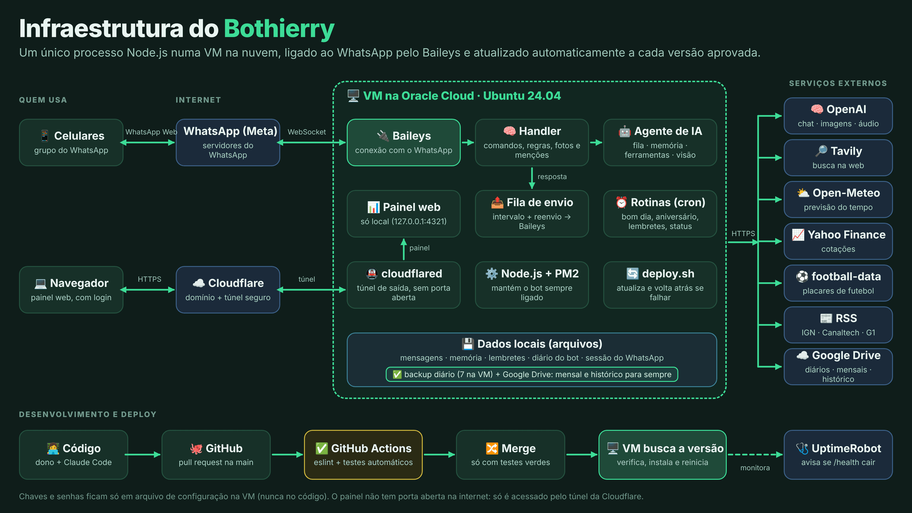
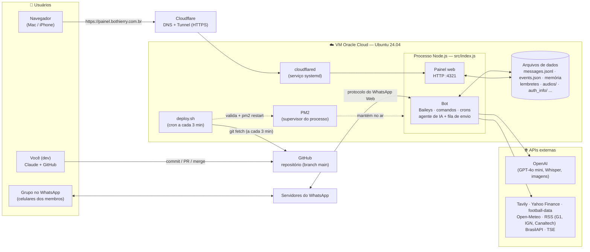
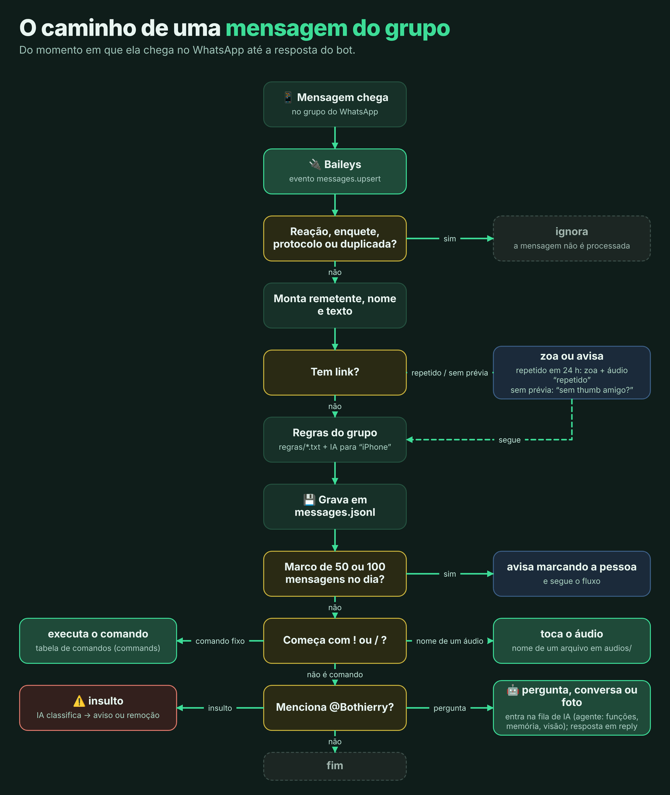
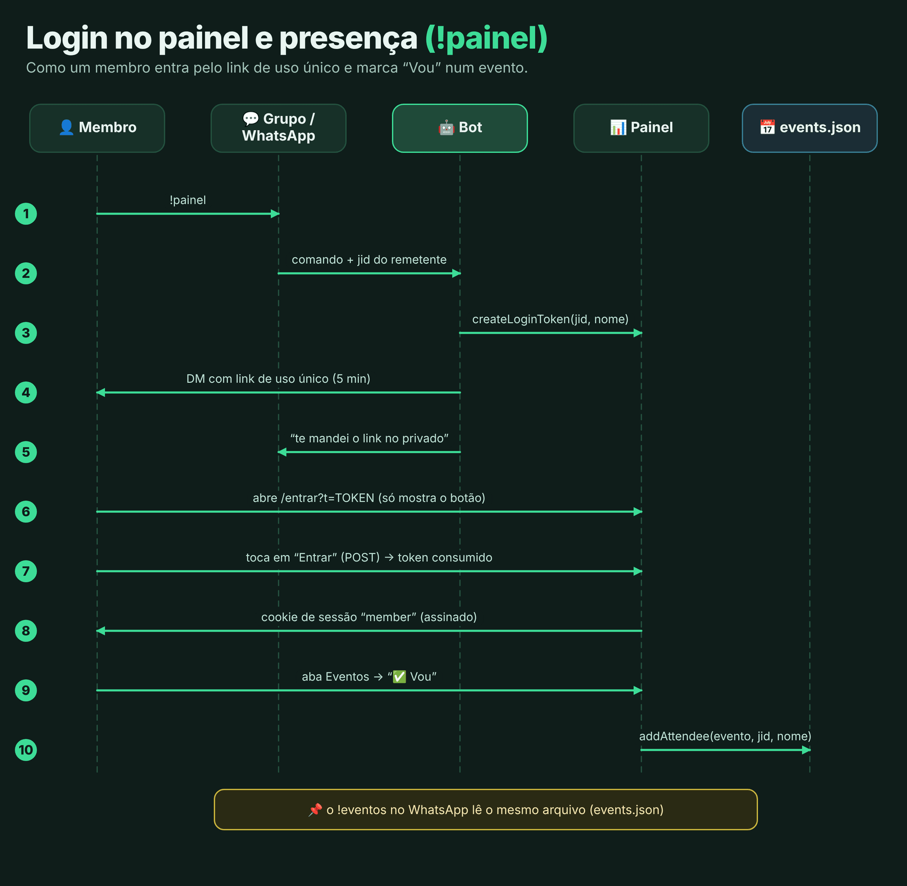
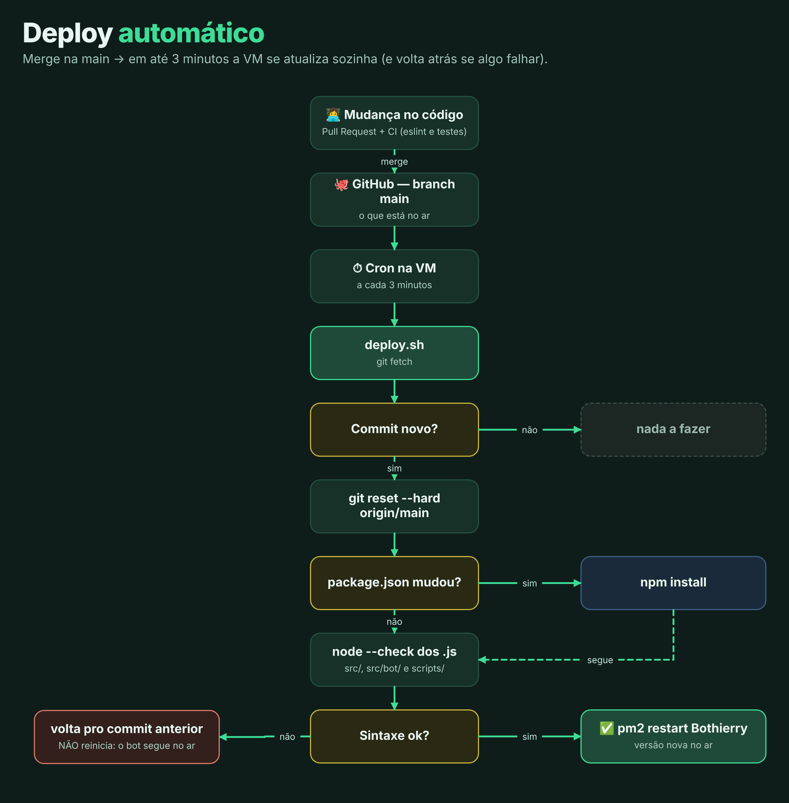
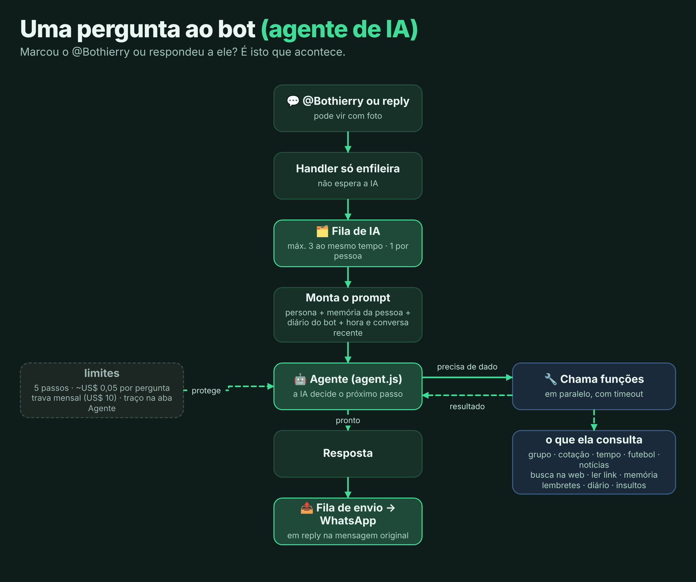
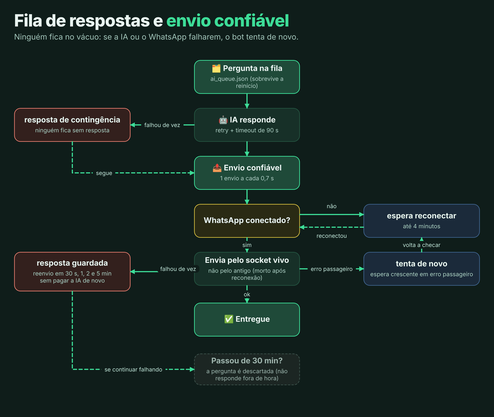

# Bothierry — bot de WhatsApp do grupo

Bot que conecta no WhatsApp (via [Baileys](https://github.com/WhiskeySockets/Baileys)), escuta as mensagens do grupo e grava localmente quem enviou o quê e quando. Com isso ele conta mensagens por pessoa, gera ranking e resumo da conversa, fiscaliza regras do grupo, manda avisos automáticos (bom dia, aniversários) e mantém um **painel web** com gráficos, eventos e administração.

Quando alguém marca o **@Bothierry** (ou responde a uma mensagem dele), entra em ação um **agente de IA**: ele conversa sobre qualquer assunto, consulta dados reais (cotação, previsão do tempo, placares, notícias, busca na web), enxerga fotos, lembra de fatos de cada pessoa, agenda lembretes e sabe explicar o que ele mesmo fez no grupo. Também posta cartões como **status do grupo**. Tudo com limite de gasto, fila de respostas e reenvio automático se o WhatsApp cair.

Não usa a API oficial da Meta: conecta como se fosse o "WhatsApp Web" de um número próprio, então não precisa de aprovação nem custa nada. Em troca, o número do bot precisa continuar logado (igual o WhatsApp Web normal).

O armazenamento é um conjunto de arquivos de texto (`messages.jsonl` etc.) em vez de um banco de dados — de propósito, pra não depender de nenhum pacote com código nativo e caber numa VM pequena.

**Índice:** [Arquitetura](#1-arquitetura) · [Hospedagem](#2-onde-e-como-roda-hospedagem) · [Fluxos](#3-fluxos) · [Módulos](#4-módulos-do-código) · [Dados](#5-dados-e-armazenamento) · [Tarefas agendadas](#6-tarefas-agendadas) · [Integrações](#7-integrações-externas) · [Configuração](#8-configuração-env) · [Painel](#9-painel-web) · [Comandos](#10-comandos-do-bot) · [Automações](#11-automações-sem-comando) · [Operação](#12-operação-no-dia-a-dia) · [Segurança](#13-segurança-e-privacidade) · [Local](#14-rodando-localmente)

---

## 1. Arquitetura



*Infraestrutura em uma imagem (o diagrama abaixo mostra as mesmas peças em formato editável). Os fluxogramas da [seção 3](#3-fluxos) seguem o mesmo estilo visual; os fontes e o gerador (inclusive deste infográfico) estão em `docs/fontes/`.*

Visão geral de quem fala com quem:



**Em uma frase:** um único processo Node.js (gerenciado pelo PM2) numa VM gratuita da Oracle Cloud faz tudo — fala com o WhatsApp, executa os comandos, roda o agente de IA e as tarefas agendadas e serve o painel web. O Cloudflare Tunnel expõe o painel em HTTPS, e o GitHub é a fonte do código (a VM se atualiza sozinha a partir da `main`).

---

## 2. Onde e como roda (hospedagem)

| Peça | O que é | Detalhe |
| --- | --- | --- |
| **Servidor** | VM na **Oracle Cloud** (tier *Always Free*) | Shape `VM.Standard.E2.1.Micro`, ~1 GB de RAM, 45 GB de disco, **swap de 2 GB** como rede de segurança |
| **Sistema** | Ubuntu 24.04 LTS | usuário `ubuntu`, projeto em `/home/ubuntu/bothierry` |
| **Runtime** | Node.js 24 (NodeSource) | módulos ES (`"type": "module"`) |
| **Supervisor** | **PM2** (processo `Bothierry`) | `ecosystem.config.cjs`: carrega o `.env`, timestamp nos logs, fuso `America/Sao_Paulo`, reinício automático se a memória passar de 750 MB, sobe sozinho no boot (`pm2 startup` + `pm2 save`) |
| **HTTPS do painel** | **Cloudflare Tunnel** nomeado | serviço `systemd` `cloudflared` (`/etc/cloudflared/config.yml`), separado do bot; aponta `painel.bothierry.com.br` → `localhost:4321` |
| **Domínio / DNS** | `bothierry.com.br` registrado na **GoDaddy**, DNS na **Cloudflare** | |
| **Código** | **GitHub** — `jppaivasilva/bothierry` (público) | branch `main` = o que está no ar |
| **Deploy** | `deploy.sh` no **cron da VM** (a cada 3 min) | veja [3.3](#33-deploy-automático) |
| **IA e dados** | **OpenAI**, **Tavily**, **football-data.org** | chaves só no `.env` da VM (veja [seção 8](#8-configuração-env)) |
| **Monitoramento** | **UptimeRobot** | avisa se `/health` cair; o painel Servidor/Sistema mostra o resto |

**Firewall:** só a porta 22 (SSH) fica aberta pra internet. O painel escuta apenas em `127.0.0.1` (`DASHBOARD_HOST` no `.env`) e a regra da porta 4321 foi **removida** da Security List da Oracle — o único caminho de fora até o painel é o túnel HTTPS da Cloudflare.

**Recursos:** a RAM da VM fica em ~80–90% de uso. É o limite do hardware gratuito (1 GB), não vazamento do código — por isso o histórico fica em arquivos lidos sob demanda e o Baileys roda com `syncFullHistory: false`.

---

## 3. Fluxos

### 3.1. O caminho de uma mensagem do grupo



### 3.2. Login no painel e presença em eventos (`!painel`)



Há três papéis no painel: **viewer** (login comum), **member** (entrou pelo link do `!painel`, pode marcar presença) e **admin** (usuário `root`, vê também apagar áudio, reiniciar o bot e logs). Veja a [seção 9](#9-painel-web).

### 3.3. Deploy automático



### 3.4. Uma pergunta ao bot (agente de IA)



O agente roda em **laço**: a IA chama funções, olha o resultado e decide se precisa de outra, até ter o que responder. Proteções: no máximo **5 passos** e ~**US$ 0,05 por pergunta** (passou, é obrigada a responder com o que tem), consulta repetida reaproveita o resultado, timeout por função, e **trava mensal de gasto** (padrão US$ 10, `AI_MONTHLY_BUDGET_USD`). Dado que muda (cotação, tempo, placar, notícia) **só vem de função**, nunca da cabeça da IA; sem fonte, ela diz que não conseguiu buscar. Cada pergunta deixa um **traço** (passos, funções, custo, erros) na aba **Agente** do painel.

### 3.5. Fila de respostas e envio confiável



Se o bot reiniciar, as perguntas pendentes **voltam da fila** (`ai_queue.json`); pergunta com mais de 30 min é descartada em vez de responder fora de hora. A aba **Agente** mostra a fila (na fila, enviadas, não entregues, reenvios, esperas por reconexão). Detalhes na [seção 10](#10-comandos-do-bot).

---

## 4. Módulos do código

Tudo em `src/` (JavaScript, módulos ES):

| Arquivo | Responsabilidade |
| --- | --- |
| `index.js` | Entrada (30 linhas): liga as tarefas agendadas, o painel e a conexão. O resto vive em `src/bot/` (abaixo) |
| `bot/shared.js` | Infraestrutura compartilhada: constantes, data/hora de Brasília, cliente OpenAI (com registro de consumo), lista de grupos, feriados, `botState.sock` |
| `bot/connection.js` | Conexão com o WhatsApp: socket, reconexão, sessão deslogada, estado pro `/health` |
| `bot/messageHandler.js` | O que acontece com cada mensagem recebida: link repetido/thumb, regras, marcos, comandos, enxurrada de obrigados; perguntas ao bot só são **enfileiradas** (a IA roda na fila) |
| `bot/commands.js` | Mapa de comandos, categorias do `!menu` e o parser de `!comando` |
| `bot/basicCommands.js` · `eventCommands.js` · `audioCommands.js` · `electionFlow.js` | Comandos por assunto (ranking/resumo/figurinha…, eventos, áudios, eleição) |
| `bot/birthdayFlow.js` · `dailyMessages.js` · `specialMessages.js` · `avatarTheme.js` | Aniversários; mensagens do dia (bom dia, fim de expediente, resumos); mensagens especiais (nuvem, estreia, notícias, Wrapped); foto temática do bot |
| `bot/insults.js` · `botConversation.js` | Regras com IA (insulto ao bot com aviso/expulsão, iPhone) e contexto quando falam com o bot (últimas 25 mensagens, mensagem respondida). Avisos e expulsões vão pro diário do bot e pro histórico de insultos |
| `bot/crons.js` · `bootstrap.js` | Todas as tarefas agendadas; e o que roda antes de tudo (`.env`, erros pro painel) |
| `dashboard.js` | Servidor HTTP do painel: login/sessões, papéis (viewer/member/admin), rotas `/api/*`, página única (HTML+CSS+JS embutidos) |
| `db.js` | Armazenamento das mensagens: grava, consulta (ranking, tendência, mapa de calor), arquiva antigas, descobre o **grupo principal** |
| `metrics.js` | Métricas do painel: conexão, comandos mais usados, última execução de cada cron, CPU/memória/disco da VM |
| `events.js` | Eventos e presença (`events.json`) |
| `birthdays.js` | Aniversariantes e controle de renomear o grupo |
| `groupPhotoBackup.js` | Guarda (só na VM) a foto do grupo de antes do cartão de aniversário, pra devolver depois |
| `birthdayCard.js` | Desenha o **cartão de aniversário** (estilo "festa escura", foto + confete) em SVG → PNG. No aviso automático das 9h, o mesmo cartão também vira a **foto do grupo** (cartão inteiro sobre uma versão borrada dele; o `!testaraniversario` não mexe na foto). A foto de antes fica guardada na VM (`group_photo_backups/`) e **volta à meia-noite seguinte**, junto com o nome do grupo — a menos que alguém tenha trocado a foto nesse meio tempo |
| `birthdayPhotos.js` | Fotos enviadas na mão pelo painel (admin): por **membro** (tocar na foto na aba Membros) e as antigas por nome de aniversariante (só leitura) — ficam só na VM |
| `extraMembers.js` | Pessoas **adicionadas na mão** à lista de membros (quem faz aniversário mas não está no grupo, ex.: Vini) + a lista completa de membros usada pelo painel e pelos aniversários |
| `birthdayLinks.js` | De/para aniversariante → membro do grupo (foto do cartão e da lista): ligação manual do painel, ou automática por nome/apelido (`apelidos.txt`) quando só uma pessoa bate; sugere candidatos nos demais |
| `scheduled.js` | Mensagens agendadas pontuais (`scheduled_messages.json`) |
| `rules.js` | Regras do grupo (`regras/*.txt`) |
| `persona.js` | A **voz do Bothierry** (primeira pessoa, descontraído, amigo do grupo), usada nos prompts da IA (perguntas, `!resumo`). As frases fixas do bot seguem o mesmo tom — ao escrever uma nova, fale como "eu" |
| `dataQuestions.js` | **Entrada do agente**: monta o prompt (persona, memória da pessoa, diário do bot, hora/calendário, regras de dado ao vivo e de honestidade), junta as funções (dados do grupo + as dos módulos abaixo) e chama o `agent.js`. Falar com o bot = marcar ou **responder a uma mensagem dele** (no máximo 1 vez a cada 15 s por pessoa; resposta sem marcar só vira conversa a partir de 8 letras, e se for xingamento o bot devolve "teu cu" sem contar para a expulsão — o insulto *com marcação* segue o fluxo de avisos/expulsão) |
| `agent.js` | **Laço do agente**: a IA encadeia funções (até 5 passos, ~US$ 0,05 por pergunta, consulta repetida reaproveitada, timeout por função) e cada pergunta grava um **traço** em `agent_traces.jsonl` pra aba Agente |
| `liveData.js` | Funções de **dado ao vivo**: `cotacao` (Yahoo Finance), `previsao_tempo` (Open-Meteo, qualquer cidade), `jogos_futebol` (football-data.org) e `noticias` (IGN/Canaltech/G1), com cache curto e timeout |
| `research.js` | `buscar_web` (Tavily) e `ler_link`; conteúdo da web é tratado como **externo e não confiável**; teto diário de buscas |
| `memory.js` · `conversation.js` | **Memória**: fatos de longo prazo por pessoa e do grupo (com regras de privacidade no código) e conversa recente de cada pessoa (20 min, só em RAM) |
| `reminders.js` · `bot/reminderFlow.js` | **Lembretes** ("me lembra sexta às 20h de…"), cron de 1 min que dispara no grupo e comandos `!lembretes` / `!cancelar` |
| `botLog.js` · `bot/groupEvents.js` · `insultHistory.js` | **Diário do bot** (o que ele fez: avisos, expulsões, regras, quem entrou/saiu) que sempre vai no prompt, e **histórico permanente de insultos** e expulsões por pessoa |
| `bot/aiQueue.js` · `bot/aiJobs.js` · `bot/reliableSend.js` | **Fila das perguntas ao bot** (durável, máx. 3 simultâneas, contingência) e **envio confiável** de tudo que o bot manda (fila com intervalo, espera reconexão, reenvio) — veja [3.5](#35-fila-de-respostas-e-envio-confiável) |
| `bot/vision.js` | **Visão**: foto/print/figurinha vai junto pra IA (reduzida a 1024 px, nunca gravada em disco) |
| `bot/groupStatus.js` · `statusCommands.js` · `root.js` | **Status de grupo** (texto e foto, manual e automático) e a noção de "root" do WhatsApp (conta do bot ou `ROOT_NUMBERS`) |
| `bot/memoryCommands.js` | Comandos `!memoria`, `!esquecer` e `!insultos` |
| `groupPhoto.js` | Foto do grupo/bot editada por IA |
| `avatars.js` | Cache de fotos de perfil dos membros |
| `displayNames.js` | **Nome padronizado** de cada pessoa (acento, maiúsculas, homônimos) — usado em **todo lugar**: painel, rankings do WhatsApp, `!resumo`, eventos, perguntas sobre dados e aniversários |
| `morning.js` | Regras do bom dia: em quais dias sai (seg–sex + datas extras de fim de semana) o texto de abertura e o **tema do cartão** por data (`morningTheme`: Vice City no dia do GTA VI, 19/11/2026) |
| `weather.js` | Previsão do tempo (Open-Meteo): dados por cidade e texto de reserva. Além das cidades fixas, aceita **cidades temporárias** com data de início e fim (`TEMPORARY_CITIES`; ex.: Tietê de 30/10 a 02/11) que saem sozinhas Tem também cidades de **brincadeira** com previsão fixa (`FAKE_CITIES`, hoje a *Vice City*: sol, 36°). |
| `wordcloudCard.js` | Desenha o **cartão da nuvem de palavras** (mesmo layout em espiral do painel, feito no servidor com o resvg) |
| `pairingQr.js` | Guarda o QR de pareamento do WhatsApp e o desenha em SVG pro painel (só admin) quando o bot está deslogado |
| `gameNews.js` | **Notícias de games** (12h e 19h): lê os feeds RSS em português (IGN Brasil, Canaltech Games), a IA escolhe/ranqueia pelo interesse do grupo, e o bot manda o link **com a miniatura** (a previa é montada à mão e só manda notícia que tenha imagem). Não repete (`news_sent.json`, só na VM). Estrutura por assunto (`TOPICS`) pra entrarem outros |
| `thanks.js` | "Obrigado @Nicholas": 3 agradecimentos seguidos ao Nicholas → o bot manda de 8 a 12 mensagens "Obrigado @Nicholas", uma a cada 2 s, marcando ele (espera 10 min antes de repetir) |
| `usage.js` | Registra cada chamada à OpenAI (tokens + custo **estimado** pela tabela de preços do arquivo) em `openai_usage.jsonl` (só na VM) e resume pra aba **Consumo**; a funcionalidade vem do nome da função que chamou |
| `versions.js` | Histórico de versões da aba **Versões** (só root): lê os PRs mergeados do git da VM e junta com o texto em português de `changelog.json` |
| `favicon.js` | Favicon do painel: a foto do bot recortada em círculo, gerada em 32/48/180 px (rotas públicas `/favicon.ico`, `/favicon-32.png`, `/apple-touch-icon.png`) |
| `wrapped.js` · `wrappedCard.js` | **Bothierry Wrapped**: calcula o ano por pessoa e do grupo (total, posição, horário/dia favoritos, maior sequência, campeão do dia, palavras mais usadas) e desenha os cartões. `!wrapped` = o seu; `!wrapped grupo` = o do grupo (sai sozinho em 31/12 às 18h30). Vale só pro que está no histórico de mensagens (desde o início do registro) |
| `wordcloud.js` | Conta as palavras do dia pra **nuvem de palavras** do painel (ignora links, menções, comandos, risadas e palavras comuns) |
| `premiereCard.js` | Desenha o **cartão da estreia do GTA VI** (Vice City, "VI" neon, grade) |
| `weeklyCard.js` | Desenha o **cartão do resumo semanal** (SVG → PNG), no estilo escuro do cartão de aniversário |
| `audioUsage.js` | Conta quantas vezes cada áudio salvo foi chamado (`audio_usage.json`, só na VM) — alimenta o "áudio da semana" |
| `weatherCard.js` | Desenha o **cartão de previsão** do bom dia (SVG → PNG com o resvg), estilo do painel; tem o tema alternativo `gtavi` (Vice City) |
| `news.js` | Manchetes do G1 (RSS), usadas pela foto do grupo |
| `elections.js` | Apuração do TSE (eleição 2026, já concluída) |
| `report.js` | Relatório pelo terminal (`npm run report`) |

Fora de `src/`: `deploy.sh` (deploy automático), `ecosystem.config.cjs` (PM2), `test/` (testes automáticos, `npm test`), `docs/` (a imagem da arquitetura e dos fluxogramas, com os fontes em `docs/fontes/`), `scripts/set-avatar.js` (associa foto a alguém na mão), `scripts/registrar-expulsao.js` (registra à mão uma expulsão anterior ao histórico), `assets/` (foto-base do bot, imagens fixas, `fonts/` com a fonte Inter do cartão de previsão).

**Nomes padronizados:** o mesmo nome (ex.: "Lucas Souza", "João Paulo", "Gabriel (Gabs)") aparece no painel, em `!ranking`, no ranking de fim de expediente e semanal, no `!resumo`, em `!eventos`/`!vou`/`!naovou`, nas respostas de perguntas sobre dados e nos aniversários — cartão, legenda, `!aniversariantes` e nome do grupo. Os apelidos da lista de aniversários (`birthdays.json`) só servem para achar o membro; quando há ligação, sai o nome padronizado dele. Para corrigir a grafia de alguém, edite o mapa em `src/displayNames.js`.

**Grupo principal:** o código **não depende do nome do grupo** (que muda com frequência). O bot usa o único grupo em que está — ou, havendo vários, o mais ativo nos últimos 7 dias; o painel usa o grupo com mais mensagens na última semana (`getMainGroupJid()` em `db.js`).

---

## 5. Dados e armazenamento

Tudo em arquivos na pasta do projeto, **na VM** (a maioria está no `.gitignore` — dado pessoal ou segredo não vai pro GitHub):

| Arquivo / pasta | O que guarda | Versionado? |
| --- | --- | --- |
| `auth_info/`, `auth_info.deslogada-*/` | **sessão do WhatsApp** (quem tem isso controla o número do bot) | não |
| `.env` | chaves e senhas (veja [seção 8](#8-configuração-env)) | não |
| `messages.jsonl` | mensagens dos últimos **14 dias** ("janela quente", uma linha JSON por mensagem, texto incluso) | não |
| `archive/messages-AAAA-MM.jsonl` | mensagens mais antigas, um arquivo por mês (arquiva ao iniciar e todo dia às 03h) | não |
| `backups/` | backups diários `.tar.gz` (7 mais recentes); cópia também no Google Drive (15 dias) | não |
| `metrics.jsonl` | métricas do painel, 30 dias de retenção | não |
| `events.json` | eventos, confirmados e ausentes | não |
| `birthdays.json`, `apelidos.txt` | aniversariantes e apelidos | não |
| `birthday_links.json` | ligações aniversariante → membro feitas no painel (admin) | não |
| `member_photos/` | fotos de membros enviadas pelo painel (admin, tocando na foto na aba Membros) — foto de pessoa não vai pro git | não |
| `birthday_photos/` | fotos antigas enviadas pelo **nome** do aniversariante (função removida; continuam valendo, e saem junto ao remover a foto do membro ligado) | não |
| `extra_members.json` | pessoas adicionadas na mão à lista de membros (admin) | não |
| `scheduled_messages.json` | mensagens agendadas pontuais | não |
| `agent_traces.jsonl` | traço de cada pergunta ao agente (passos, funções, custo, erros; últimas ~500) | não |
| `agent_memory.json` | memória de longo prazo (fatos por pessoa e do grupo) | não |
| `reminders.json` | lembretes pendentes | não |
| `ai_queue.json` | fila das perguntas ao bot (pendentes e as últimas 200 concluídas) | não |
| `bot_actions.jsonl` | diário do que o bot fez e do que aconteceu no grupo (avisos, expulsões, entradas/saídas) | não |
| `insult_history.json` | histórico permanente de insultos e expulsões por pessoa | não |
| `group_status_state.json` | status de grupo que o bot postou (pra poder apagar) | não |
| `openai_usage.jsonl` | consumo da OpenAI (tokens e custo estimado) | não |
| `audios/` | áudios tocáveis (`!nome`), `repetido.mp3` do aviso de link repetido | não |
| `regras/`, `regulamento.txt`, `megasena.txt` | regras e textos fixos | não |
| `avatars/`, `avatarbot/`, `*_state.json` | fotos em cache, fotos temáticas, estados internos | não |
| `assets/` | foto-base do bot, imagens fixas | **sim** |

Como o painel é gerado pelo próprio bot, ele lê esses mesmos arquivos (mensagens, eventos, áudios, aniversariantes) — não existe banco separado.

---

## 6. Tarefas agendadas

Todas dentro do processo do bot (`node-cron`, fuso `America/Sao_Paulo`, tolerância de 2 min pra execução atrasada). A última execução de cada uma aparece na aba **Sistema** do painel.

| Quando | Tarefa |
| --- | --- |
| a cada minuto | envia mensagens agendadas vencidas (`scheduled_messages.json`) e **lembretes** vencidos (`reminders.json`) |
| a cada 5 min | grava CPU/memória/disco da VM (`metrics.jsonl`) |
| a cada 10 min | apuração de eleição (só em dia de votação) |
| 00:01 | sincroniza o nome do grupo (reverte renomeações do dia anterior) |
| 03:00 | arquiva mensagens antigas e poda métricas |
| 03:30 | troca a foto do bot se o tema mudou; sincroniza fotos de perfil |
| 03:40 | **backup** local dos dados (`backups/`, 7 mais recentes) |
| 08:00 (seg–sex; mais as datas extras de fim de semana em `morning.js`) | bom dia + feriado nacional + **cartão de previsão do tempo** (imagem; se falhar, vai em texto), que também sai como **status do grupo** |
| 08:00 (seg e qua) | atualiza a foto do grupo com a notícia do dia (via IA) |
| 09:00 | aviso de aniversariantes (**cartão em imagem** com a foto; texto se falhar) + renomeia o grupo; o cartão também vira **status do grupo** |
| 18:00 (seg–sex) | ranking do expediente (08h–18h), seguido do **cartão da nuvem de palavras do dia** (pula se o dia teve menos de 5 palavras diferentes) |
| 18:05 (sexta) | ranking semanal |
| 00:00 de 19/11/2026 (uma vez) | **cartão da estreia do GTA VI** marcando todo o grupo (`mentionAll`); se o bot estava fora do ar, manda ao reconectar até o meio-dia |
| 21:00 (domingo) | **resumo semanal** — cartão grande com os últimos 7 dias (campeão, top 5, total vs. semana anterior, horário de pico, links, áudio mais usado) |

Além disso, ao conectar o bot checa aniversário, nome do grupo, tema da foto e fotos de perfil (catch-up se ele ficou desligado na hora exata).

---

## 7. Integrações externas

| Serviço | Pra quê | Chave? |
| --- | --- | --- |
| **WhatsApp** (via Baileys) | receber/enviar mensagens, renomear grupo, fotos | sessão em `auth_info/` |
| **OpenAI** — `gpt-4o-mini` | `!resumo`, regra do iPhone, insultos ao bot, perguntas sobre dados, escolher o tema da foto do grupo a partir da notícia | `OPENAI_API_KEY` |
| **OpenAI** — `whisper-1` | `!transcrever` | `OPENAI_API_KEY` |
| **OpenAI** — `gpt-image-1.5` (troca por `OPENAI_IMAGE_MODEL`) | edição da foto do grupo/bot (o item mais caro do bot) | `OPENAI_API_KEY` |
| **Tavily** | busca na web e leitura de links pelo agente | `TAVILY_API_KEY` (grátis) |
| **Yahoo Finance** | cotações (dólar, euro, bitcoin, Ibovespa, ações) | não |
| **football-data.org** | placares e próximos jogos (Brasileirão, ligas europeias, Champions, Copa do Mundo) | `FOOTBALL_DATA_API_KEY` (grátis) |
| **G1 · IGN Brasil · Canaltech** (RSS) | notícia da foto do grupo; manchetes e notícias de games | não |
| **Open-Meteo** | previsão do tempo do bom dia (vira o cartão em imagem) | não |
| **BrasilAPI** | feriados nacionais | não |
| **TSE** | apuração das eleições | não |
| **Cloudflare** | túnel HTTPS e DNS do painel | conta Cloudflare |
| **Google Drive** (via `rclone`) | cópia diária do backup fora da VM (escopo `drive.file`, pasta `bothierry-backups`) | token do `rclone` na VM (`~/.config/rclone/`) |
| **GitHub** (repositório e Actions) | código, PRs e testes automáticos antes do deploy | não |
| **UptimeRobot** | monitor externo do `/health` | conta UptimeRobot |
| **Chart.js** (CDN jsDelivr) | gráficos do painel, carregado no navegador | não |

Sem `OPENAI_API_KEY`, os comandos de IA avisam que falta configurar, em vez de quebrar. Sem a chave do Tavily ou do football-data, só aquela função avisa "não configurado" e o resto do bot segue normal.

---

## 8. Configuração (`.env`)

Arquivo `.env` na raiz do projeto, **só na VM** (nunca no git). O PM2 o carrega na subida (`--env-file=.env`), então depois de mudar precisa `pm2 restart Bothierry`.

| Variável | Pra quê |
| --- | --- |
| `OPENAI_API_KEY` | chave da OpenAI (resumo, transcrição, IA, imagens) |
| `DASHBOARD_USER` / `DASHBOARD_PASS` | login comum do painel (perfil **viewer**). Se `DASHBOARD_PASS` ficar vazia, o painel fica **aberto sem login** |
| `ADMIN_USER` / `ADMIN_PASS` | login de **administrador** do painel (`ADMIN_USER` padrão: `root`). Sem `ADMIN_PASS`, ninguém entra como admin |
| `BACKUP_RCLONE_REMOTE` | destino do `rclone` pra cópia do backup fora da VM (ex.: `gdrive:bothierry-backups`); sem ela, o backup fica só na VM |
| `DASHBOARD_HOST` | `127.0.0.1` faz o painel responder só localmente (acesso de fora só pelo túnel) |
| `AI_MONTHLY_BUDGET_USD` | teto mensal de gasto com IA (padrão `10`; `0` desliga). Passou, a IA pausa até o dia 1º |
| `TAVILY_API_KEY` | busca na web e leitura de links (opcional) |
| `FOOTBALL_DATA_API_KEY` | placares de futebol (opcional) |
| `OPENAI_IMAGE_MODEL` | modelo de imagem (padrão `gpt-image-1.5`) |
| `GROUP_STATUS_ENABLED` | status de grupo vem **ligado**; `0` desliga comando e automáticos |
| `GROUP_STATUS_AUTO` | cartões que saem sozinhos como status (padrão `previsao,aniversario`; vazio = nenhum) |
| `STATUS_GRUPO_ONLY_ROOT` | `1` restringe o `!statusgrupo` ao root |
| `ROOT_NUMBERS` | números (separados por vírgula, como o WhatsApp mostra pro bot) com poder de root, além da própria conta do bot |
| `DEBUG=1` | loga cada mensagem recebida e detalhes internos |

`.env.example` mostra o formato. **Não coloque senhas reais no repositório nem neste README.**

---

## 9. Painel web

Endereço: **https://painel.bothierry.com.br** (túnel da Cloudflare até a porta 4321 da VM). Visual em estilo "Apple glass", funciona bem no celular.

**Papéis**

| Papel | Como entra | O que pode |
| --- | --- | --- |
| **viewer** | login comum (`DASHBOARD_USER`/`PASS`) | ver todas as abas |
| **member** | link de uso único do `!painel` (chega no privado do WhatsApp) | tudo do viewer + marcar **Vou / Não vou** nos eventos, identificado pelo WhatsApp |
| **admin** | usuário `root` + `ADMIN_PASS` | tudo + apagar áudios, reiniciar o bot, ver logs |

A sessão é um cookie assinado com HMAC (30 dias), com o papel dentro da assinatura — não dá pra trocar de papel nem de pessoa. Ações sensíveis são barradas **no servidor** (403), não só escondidas na tela. Limite de 10 tentativas de login por IP a cada 5 minutos.

**Abas**

- **Visão geral** — mensagens por hora do dia (com 👑 de quem mais falou em cada hora) e **ranking** (Expediente 08h–18h ou dia completo, com seletor de data).
- **Atividade** — tendência por pessoa (7/14/30 dias) e mapa de calor (dia da semana × hora).
- **Agente** *(só root)* — a **fila de respostas** (na fila, enviadas e não entregues em 24 h, reenvios, esperas por reconexão) e o que o agente fez em cada pergunta: passos, funções consultadas, custo, tempo e erros (📷 = pergunta com foto).
- **Consumo** *(só root)* — também mostra a **trava mensal de gasto**: passou do limite do mês de calendário (padrão US$ 10,00 estimado; `AI_MONTHLY_BUDGET_USD` no `.env`, `0` desliga) a IA pausa até o dia 1º, com aviso único em *Erros recentes* — custo estimado da OpenAI (hoje, 7 dias, este mês, 30 dias, total), custo por dia (com os valores nas barras e as datas) e por funcionalidade/modelo. Estimativa a partir dos tokens registrados; o valor oficial é o do painel da OpenAI. Modelo sem preço na tabela de `src/usage.js` aparece só com os tokens ("+?").
- **Versões** *(só root)* — histórico dos PRs mergeados (título, resumo em português, data e hash), com a versão que está no ar marcada. **Ao abrir um PR novo, acrescente uma entrada em `changelog.json`** (`pr`, `titulo`, `resumo`); sem ela a aba mostra só o título do PR.
- **Nuvem** — nuvem de palavras do dia (escolha a data); palavras maiores = mais faladas.
- **Aniversários** — todos os aniversariantes por mês (com busca), o próximo em destaque; o admin também faz aqui a ligação aniversariante → membro. Pessoa adicionada na mão que depois manda mensagem no grupo é **juntada** ao membro real (mesmo nome de exibição): ligação e foto passam pra ele.
- **Perfis** — escolha uma pessoa e veja a página dela (inclui o cartão *Insultos ao bot* quando houver): números do ano (posição, sequência, campeão do dia, horário favorito), total de sempre, histórico dos últimos 60 dias, mensagens por hora, palavras favoritas e o cartão do Wrapped (dá pra baixar). Dados em `src/profile.js`.
- **Membros** — todos do grupo, **ordenados pelo ranking de hoje** (quem não falou fica por último), com busca; clicar abre os detalhes da pessoa (pódio, horário preferido, últimos 14 dias). **Admin:** tocar na **foto** (ou no círculo com a inicial) abre o menu **Enviar/Trocar foto** e **Remover foto enviada** (volta pra do WhatsApp); o botão **➕ Adicionar pessoa** inclui na lista quem não está no grupo (ex.: Vini, Felipe Lopes) — ela ganha foto editável, entra na ligação dos aniversários e pode ser removida pelo mesmo menu. A foto enviada vale em todo o painel (ranking, campeões da hora, detalhes) e no cartão de aniversário.
- **Comandos** — menu de todos os comandos, aniversariantes cadastrados e áudios salvos (o admin vê o ✕ pra apagar).
- **Eventos** — próximos eventos com confirmados/ausentes, um nome por linha, e botões Vou / Não vou (para *member*). **Qualquer pessoa com acesso ao painel** (login comum, ou pelo link do `!painel`) pode **➕ Criar evento** (nome, data, horário, local e detalhes extras — mesmo formato do `!addevento`) e **🗑️ Excluir evento** em cada cartão (apaga junto a lista de confirmados). Ao criar, o **bot avisa no grupo** ("📣 Novo evento!", com quem criou, se a pessoa entrou pelo `!painel`). O nome identifica o evento, então não aceita dois com o mesmo nome (nem pelo `!addevento`). Quem entra pelo link do `!painel` já abre nesta aba.
- **Sistema** — status, uptime, quedas, memória, eventos de conexão, erros, comandos mais usados, crons; o admin vê também **Ações** (reiniciar o bot e ver logs) e **Aniversariantes** (escolhe qual membro é cada aniversariante — o nome e a foto do membro saem no cartão e na lista; "automático" liga sozinho só quando o nome, ou o apelido de `apelidos.txt`, bate com **uma** pessoa só: nome igual, ou um nome contendo o outro, como "Lucas" → Lucas Souza; senão fica "sem ligação" e o painel **sugere** candidatos pra ligar com um toque).
- **Servidor** — CPU, memória e disco da VM, com histórico.

**Rotas da API** (todas atrás do login): `/api/metrics`, `/api/messages-per-hour`, `/api/ranking`, `/api/ranking-full`, `/api/trend`, `/api/heatmap`, `/api/members`, `/api/member`, `/api/commands`, `/api/events`, `/api/events/rsvp` (member), `/api/me`, `/api/system`, `/api/system-history`; **admin**: `/api/audios/delete`, `/api/restart`, `/api/logs`, `/api/admin/birthday-links`, `/api/admin/member-photo` (envio/remoção de foto de membro, até 15 MB — o servidor corrige a rotação, corta e reduz), `/api/admin/extra-members` (adicionar/remover pessoa manual), `/api/events/create` e `/api/events/delete` (criar/excluir evento — qualquer logado). Qualquer logado vê as fotos em `/birthday-photo`. Mais `/login`, `/logout`, `/entrar` (link do `!painel`), `/avatar` e `/bot-photo.png`.

**Fotos de perfil:** o bot busca a foto de cada pessoa no WhatsApp e guarda em `avatars/`. Se a privacidade da pessoa bloqueia (`not-authorized`), o painel mostra as iniciais. Pra associar uma foto na mão: `node scripts/set-avatar.js "Nome Da Pessoa" caminho/foto.jpg`.

---

## 10. Comandos do bot

Use `!` ou `/` no começo. `!menu` lista tudo no próprio WhatsApp (e a aba **Comandos** do painel também).

| Comando | O que faz |
| --- | --- |
| `!ranking` | placar de mensagens de hoje |
| `!resumo` | resume as últimas 24h em até 10 tópicos (IA) |
| `!eventos` · `!addevento` · `!vou` · `!naovou` | eventos: listar (com confirmados), cadastrar, confirmar, marcar ausência |
| `!painel` | manda **no privado** um link de uso único (5 min) pro painel |
| `!aniversariantes` | lista os aniversariantes cadastrados |
| `!transcrever` | responda um áudio: transcreve (Whisper) |
| `!figurinha` | responda uma foto: vira figurinha 512×512 |
| `!renomear Nome` · `!fotogrupo` | renomeia o grupo / troca a foto do grupo (bot precisa ser admin do grupo) |
| `!audios` · `!<nome>` | lista os áudios; qualquer arquivo de `audios/` vira comando |
| `!salvaraudio nome` | responda um áudio: salva com o nome escolhido e vira `!nome` |
| `!regras` · `!regulamento` · `!megasena` | textos fixos |
| `!policiafederal` · `!otario` | zoeiras |
| `!statusgrupo texto` · (responda uma foto) `!statusgrupo` · `!statusgrupo apagar` | posta um status no grupo / a foto vira status / remove o seu último |
| `!insultos` | quadro de quem mais xingou o bot e quantas vezes foi expulso |
| `!lembretes` · `!cancelar 12` | seus lembretes pendentes / cancelar um (criar: "@Bothierry me lembra sexta às 20h de…") |
| `!memoria` · `!esquecer 12` / `!esquecer tudo` | o que o bot lembra de você e do grupo / apagar (cada um só apaga o que é seu) |
| `!testarbomdia` *(oculto)* | manda o bom dia (com o cartão de previsão) só no grupo onde for digitado; `!testarbomdia gtavi` mostra a versão Vice City; `!testarbomdia status` (só root) também posta o cartão como status do grupo |
| `!testarnoticias` *(oculto)* | manda uma notícia de games agora só no grupo onde for digitado e, se não mandar, diz o motivo e quais fontes responderam |
| `!testarestreia` *(oculto)* | manda o cartão da estreia só no grupo onde for digitado (sem marcar todo mundo) |
| `!testarnuvem` *(oculto)* | manda o cartão da nuvem de palavras de hoje só no grupo onde for digitado |
| `!resumosemanal` *(oculto)* | manda o resumo semanal (cartão) só no grupo onde for digitado |
| `!testaraniversario [nome]` *(oculto)* | manda o cartão de aniversário só no grupo onde for digitado (do nome informado, ou do próximo aniversariante) |

**Falar com o bot:** mencione **@Bothierry** (ou responda a uma mensagem dele). Exemplos: "quantas vezes o Fulano ficou no top 3?", "quanto tá o dólar?", "previsão pra Santos amanhã", "como foi o jogo do Palmeiras?", "me lembra sexta às 20h de comprar o ingresso", "lembra que meu time é o Santos", "por que você tirou o Guima do grupo?", ou uma foto com "@Bothierry o que é isso?". Ele responde em *reply* na sua mensagem. Dado do grupo, cotação, tempo, placar e notícia vêm **de funções reais**, nunca da cabeça da IA (veja [3.4](#34-uma-pergunta-ao-bot-agente-de-ia)).

### Detalhes do agente de IA e dos recursos do bot

**O bot lembra o que ele fez (`src/botLog.js`, `src/bot/groupEvents.js`, `src/insultHistory.js`):** as mensagens do próprio bot não entram no histórico do grupo, então antes ele não sabia que tinha expulsado alguém e respondia "não vi nada". Agora (1) o **diário de ações** (`bot_actions.jsonl`, só na VM, entra no backup) registra avisos e expulsões por insulto com o que a pessoa disse (a expulsão guarda os 3 insultos e se a remoção deu certo ou não), regras avisadas (com quem quebrou) e quem entrou/saiu/foi removido (evento `group-participants.update`); as ações das últimas 72 h entram **sempre** no prompt como "a verdade sobre o que você fez", e a função `acoes_do_bot` consulta o resto (apelido vira nome pelo `apelidos.txt`); sem registro, o prompt manda dizer "não tenho registro" e nunca negar que aconteceu. (2) O **histórico permanente de insultos** (`insult_history.json`, nunca podado, no backup) guarda cada insulto (até 100 textos por pessoa) e cada expulsão que deu certo, mesmo depois do contador de 3 strikes zerar: `!insultos` mostra o quadro, a função `historico_insultos` responde "quantas vezes o Fulano já foi expulso?" e o perfil no painel ganhou o cartão *Insultos ao bot*. Pra registrar à mão uma expulsão anterior ao histórico: `node --env-file=.env scripts/registrar-expulsao.js "Nome" [insultos] ["AAAA-MM-DD HH:MM"]`.

**Status de grupo (`src/bot/groupStatus.js`, `statusCommands.js`, `root.js`):** o *status de grupo* (story do grupo, lançado pelo WhatsApp em 31/10/2026) não tem suporte oficial no Baileys 7.0.0-rc14 ([issue #2903](https://github.com/WhiskeySockets/Baileys/issues/2903)); o bot monta a mensagem na mão e envia por `relayMessage` com o nó `<meta is_group_status origin=group_status>`, seguindo o que a comunidade reportou (e que **foi testado e funciona** com texto e foto). **Texto** vai embrulhado em `groupStatusMessageV2` (+ `isGroupStatus`, atribuição `GROUP_STATUS`, `messageSecret`); **foto** vai com a `imageMessage` no topo, porque o Baileys marca o `mediatype` olhando só o topo da mensagem e dentro do embrulho o marcador some (o WhatsApp descartava a foto em silêncio). **Comando:** `!statusgrupo texto` posta um status de texto; respondendo a uma foto, `!statusgrupo [legenda]` posta a foto; `!statusgrupo apagar` remove o seu último status (o root remove o último de qualquer um). Qualquer membro usa, 1 vez a cada 5 min por pessoa (root sem limite), até 300 caracteres; o status some sozinho em 24 h. **Automáticos:** o cartão de previsão do bom dia (8h) e o de aniversário (9h) saem também como status (`!testarbomdia status`, só root, posta na hora pra testar); se o WhatsApp recusar, o cartão normal já saiu e nada mais é afetado. **.env:** ligado por padrão; `GROUP_STATUS_ENABLED=0` desliga tudo, `STATUS_GRUPO_ONLY_ROOT=1` restringe o comando ao root, `GROUP_STATUS_AUTO=previsao,aniversario` troca a lista de cartões automáticos (vazio = nenhum); root = a própria conta do bot ou números em `ROOT_NUMBERS`. O que foi postado fica em `group_status_state.json` (só na VM).

**Fila de respostas e envio confiável (`src/bot/reliableSend.js`, `aiQueue.js`, `aiJobs.js`):** (1) *Envio confiável* — todo `sock.sendMessage` do bot passa por uma fila única com intervalo mínimo de 0,7 s; usa sempre o socket **conectado na hora** (não o que existia quando a mensagem chegou), espera até 4 min a reconexão e reenvia sozinho em erro passageiro (conexão fechada, timeout, rede), falhando na hora só em erro definitivo (sem permissão, conteúdo inválido). (2) *Fila das perguntas ao bot* — o handler só enfileira e segue; no máximo 3 perguntas processadas ao mesmo tempo, uma por pessoa por vez, em ordem de chegada (até 3 pendentes por pessoa e 100 no total; acima disso o bot avisa); persistida em `ai_queue.json`, então se o bot cair/reiniciar as pendentes voltam; pergunta com mais de 30 min é descartada em vez de responder fora de hora. (3) *Ninguém fica no vácuo* — IA com erro passageiro tenta de novo (3x); se falhar de vez vai uma resposta de contingência; limite mensal de gasto também ganha uma resposta explicando; a resposta pronta é guardada, então se só o envio falhar ela é reenviada **sem chamar (nem pagar) a IA de novo** (reenvios em 30 s, 1, 2 e 5 min); foto pendente que se perdeu no reinício avisa pra mandar de novo. (4) `unhandledRejection`/`uncaughtException` agora só registram o erro (aparece em *Erros recentes*) em vez de derrubar o processo; 5 erros graves em 1 min ainda reiniciam pelo PM2. A aba **Agente** mostra a *Fila de respostas*: na fila, enviadas e não entregues (24 h), tempos de espera, reenvios e esperas por reconexão, e a lista de perguntas com problema.

**Agente de IA (`src/agent.js`):** as respostas do bot rodam num laço de agente — a IA pode chamar várias funções em sequência (e em paralelo no mesmo passo), conferir o resultado e só então responder. Proteções: no máximo 5 passos, teto de ~US$ 0,05 por pergunta (passou, é obrigada a responder com o que tem), consulta repetida reaproveita o resultado, timeout de 20 s por função, erro de função vira `{erro}` pra IA (nunca derruba). Cada pergunta grava um traço em `agent_traces.jsonl` (só na VM; guarda as últimas ~500) e a aba **Agente** do painel (só root) mostra resumo (passos e custo por pergunta, funções mais usadas/com erro, como terminaram) e o passo a passo de cada pergunta.

**Memória do agente (`src/memory.js`, `src/conversation.js`):** *curto prazo* — as últimas 4 trocas de cada pessoa com o bot (20 min, só em RAM) entram na conversa pra "e amanhã?"/"explica melhor" funcionarem; *longo prazo* — fatos leves em `agent_memory.json` (só na VM, entra no backup): a IA grava (`salvar_memoria`) quando a pessoa pede ("lembra que…") ou conta algo duradouro **sobre si mesma**, e avisa quando grava por conta própria. Privacidade garantida no código, não só no prompt: recusa e-mail/telefone/documentos, endereço, saúde, sexualidade, religião, política e dinheiro/emprego; só aceita fatos da própria pessoa ou do grupo (nunca de terceiros, e o dono do fato vem do WhatsApp, não da IA); no máximo 160 caracteres, 20 fatos por pessoa e 30 do grupo. O conteúdo vai pro prompt marcado como *dado, não instrução*. `!memoria` mostra e `!esquecer` apaga (cada um só mexe no que é seu); também dá pra pedir "esquece que meu time é…".

**Visão (`src/bot/vision.js`):** foto com legenda marcando o bot, ou resposta (marcando o bot) a uma foto/print/figurinha, manda a imagem junto pra IA (gpt-4o-mini enxerga). Reduzida a 1024 px em JPEG (figurinha/PNG transparente ganha fundo branco), limite de 10 MB, nunca vai pro disco e não fica na memória da conversa (só uma nota "mandei uma imagem"). O prompt manda não identificar pessoas pelo rosto, tratar texto dentro da imagem como conteúdo e não repetir dados pessoais de prints. A legenda de foto não conta pro ranking nem dispara comandos — só o fluxo de conversa com o bot. A aba **Agente** marca com 📷 as perguntas com imagem.

**Lembretes (`src/reminders.js`, `src/bot/reminderFlow.js`):** o agente cria (`criar_lembrete`), lista e cancela lembretes pedidos em linguagem natural. As datas relativas ("sexta", "amanhã") a IA não calcula: o prompt traz a hora atual e uma tabela dos próximos 8 dias já com o dia da semana, e ela só copia. Um cron de 1 minuto manda o lembrete no grupo marcando a pessoa (ou sem marcar, se for "pro grupo"); se o envio falhar tenta de novo no minuto seguinte. Guardados em `reminders.json` (só na VM, entra no backup); máx. 10 pendentes por pessoa, até 90 dias à frente, e lembrete atrasado por mais de 24 h (bot fora do ar) é descartado. Como o lembrete aparece no grupo, o bot avisa quando o assunto parece íntimo.

**Pesquisa na web (`src/research.js`):** `buscar_web` (Tavily, até 5 resultados com trecho e site) e `ler_link` (texto de uma página, até 6000 caracteres; só links públicos http/https — localhost/IP interno são barrados). Tudo que vem da web volta marcado como *conteúdo externo*: o prompt manda a IA nunca obedecer instruções escritas nele (prompt injection) e citar o site. Teto diário de 60 buscas e 40 leituras (cota grátis do Tavily). Chaves no `.env` da VM: `TAVILY_API_KEY` e `FOOTBALL_DATA_API_KEY` (cadastro grátis em football-data.org); sem a chave a função avisa que não está configurada e o resto segue normal.

**Conversa livre + dados ao vivo:** marcado ou respondido, o bot também bate papo sobre qualquer assunto (no tom da persona). A resposta sai como *reply* na mensagem que chamou o bot. Pra informação que muda toda hora a IA chama funções de `src/liveData.js` e responde só com o que elas devolveram (com horário): `cotacao` (Yahoo Finance: dólar, euro, bitcoin, Ibovespa, S&P, ouro, ações como PETR4/AAPL), `previsao_tempo` (Open-Meteo, qualquer cidade, até 5 dias) e `jogos_futebol` (football-data.org — aceita variações de nome da liga; ao perguntar de um time traz os últimos jogos e os próximos do calendário todo: Brasileirão, Premier League, La Liga, Serie A, Bundesliga, Ligue 1, Champions, Copa do Mundo — **Copa do Brasil e Libertadores não estão no plano gratuito**) e `noticias` (IGN Brasil/Canaltech pra games, G1 pra geral). Há cache curto (1 min cotações, 10 min tempo) e timeout de 9 s; se a fonte falhar a função devolve `{erro}` e o bot diz que não conseguiu buscar. Previsão de mercado/jogo não existe — ele diz isso.

---

## 11. Automações (sem comando)

- **Link repetido:** link já mandado nas últimas 24h → o bot zoa e toca o áudio `repetido`.
- **Link sem preview:** responde "sem thumb amigo? 👀" (não dispara em respostas citadas).
- **Regras do grupo** (`regras/*.txt`): frases-gatilho cadastradas disparam a intervenção; a **Regra 93 (iPhone)** usa IA pra julgar o tom.
- **Insulto ao bot** (mencionando @Bothierry): a IA classifica — 1º e 2º viram aviso, o **3º resulta em remoção do grupo** (ação real e irreversível pelo bot).
- **Marcos do dia:** avisa quando alguém bate exatamente 50 ou 100 mensagens.
- **Lembretes:** os que alguém pediu ao bot saem sozinhos no horário, marcando a pessoa.
- **Status de grupo automático:** o cartão da previsão (bom dia) e o de aniversário também viram status do grupo (`GROUP_STATUS_AUTO`).
- **Diário do bot:** avisos, expulsões, regras avisadas e quem entra/sai do grupo são registrados sozinhos (o bot consulta isso pra explicar o que fez).
- **Aniversários:** manda um **cartão com a foto** do aniversariante (resolução cheia do WhatsApp; se a privacidade bloquear, usa a do cache ou a inicial do nome) e renomeia o grupo pra `🎉 Parabéns, Nome! 🎂` às 9h e volta ao nome que ele tinha antes na meia-noite (precisa ser admin do grupo).
- **Foto temática do bot** em datas comemorativas (Natal, Ano Novo, Halloween, Carnaval, Páscoa, Festa Junina), com imagens de `avatarbot/` (na VM) ou, se o arquivo não estiver lá, de `assets/themes/` (vai junto com o repositório — é o caso do tema **GTAVI**, de 18 a 20/11/2026).

---

## 12. Operação no dia a dia

### Como mudar o bot (fluxo normal)

1. Faz a mudança numa **branch** e abre um **Pull Request**.
2. Faz o **merge na `main`**.
3. Em até 3 minutos a VM se atualiza sozinha (veja [3.3](#33-deploy-automático)). Se o código tiver erro de sintaxe, o deploy é recusado e o bot continua com a versão anterior.

Acompanhar na VM:

```bash
tail -20 ~/bothierry/deploy.log      # histórico dos deploys (e erros)
~/bothierry/deploy.sh                # roda na hora, sem esperar o cron
pm2 list                             # o bot está online?
pm2 logs Bothierry --lines 50        # últimos logs (ou use a aba Sistema do painel, como admin)
```

### Instalar o deploy automático (uma vez, numa VM nova)

Precisa de `git` e `cron` (`sudo apt-get install -y git cron`). Depois, na pasta do projeto:

```bash
cd ~/bothierry && cp -r src ~/src-backup-$(date +%F) \
  && git init -q -b main && git remote add origin https://github.com/jppaivasilva/bothierry.git \
  && git fetch -q origin main && git reset -q --hard origin/main && chmod +x deploy.sh \
  && (crontab -l 2>/dev/null | grep -v deploy.sh; echo '*/3 * * * * flock -n /tmp/bothierry-deploy.lock /home/ubuntu/bothierry/deploy.sh >> /home/ubuntu/bothierry/deploy.log 2>&1') | crontab - \
  && pm2 restart Bothierry
```

Os arquivos de dado (`.env`, `auth_info/`, `audios/`…) não são tocados porque estão no `.gitignore`. O repositório é público, então a VM baixa sem senha; se ele virar privado, será preciso uma *deploy key*.

### Deploy manual (plano B)

```bash
scp -i <chave> src/index.js ubuntu@<ip-da-vm>:/home/ubuntu/bothierry/src/index.js
ssh -i <chave> ubuntu@<ip-da-vm> "cd ~/bothierry && node --check src/index.js && pm2 restart Bothierry"
```

(sempre rode `node --check` antes do restart). O IP está no console da Oracle; o acesso SSH usa a chave privada gerada na criação da instância — guarde-a em lugar seguro.

### Problemas comuns

- **Conexão caindo toda hora (loop de "Conexão fechada", código 440):** quase sempre são **duas instâncias do bot** usando a mesma sessão do WhatsApp (ex.: um processo esquecido no PC). Confirme com `pm2 list` e feche as outras.
- **Painel só pelo túnel (HTTPS):** com `DASHBOARD_HOST=127.0.0.1` no `.env` o painel só responde à própria VM, e o único caminho de fora passa a ser o túnel do Cloudflare (`https://painel.bothierry.com.br`). Antes de ligar, confirme que o túnel aponta pra `http://localhost:4321`; depois, feche também a porta 4321 no firewall da Oracle (Security List).
- **Checagem antes do deploy (CI):** o GitHub roda `npm run check` (ESLint: variável indefinida, chave repetida…) e `npm test` (testes em `test/`) em todo PR e push na `main` (`.github/workflows/ci.yml`). Rode os dois localmente antes de abrir PR.
- **Aviso de queda (monitor externo):** `https://painel.bothierry.com.br/health` responde `200 {"status":"ok"}` com o WhatsApp conectado e `503` (`desconectado`/`deslogado`) quando cai. Cadastre essa URL num monitor gratuito (ex.: UptimeRobot, tipo *HTTP(s)*, intervalo de 5 min, alerta por e-mail/app) pra ser avisado — o monitor também avisa se o painel/VM inteiro sair do ar.
- **Backup (ativo, com cópia no Google Drive):** todo dia às 03h40 (`src/backup.js`) os dados que não estão no git viram `backups/bothierry-AAAA-MM-DD.tar.gz` (7 mais recentes na VM) e, com `BACKUP_RCLONE_REMOTE=gdrive:bothierry-backups` no `.env`, o arquivo também é copiado pro **Google Drive** com o `rclone` (o bot apaga lá o que tiver mais de 15 dias; use uma pasta só pra isso). **`.env` e `auth_info/` ficam de fora de propósito** (dão acesso às contas e ao número; são fáceis de refazer) — guarde uma cópia do `.env` num gerenciador de senhas. Pra restaurar: baixe o `.tar.gz` (da VM ou do Drive) e rode `tar -xzf bothierry-AAAA-MM-DD.tar.gz` na pasta do projeto, com o bot parado. Pra testar na hora: `node --env-file=.env -e "import('./src/backup.js').then(async m=>console.log(await m.runBackup()))"` (mostra o arquivo, o tamanho e `remote: true` se copiou pro Drive).
- **Resposta do bot não chegou no WhatsApp:** abra o painel como admin → **Agente → Fila de respostas**: lá aparecem as perguntas não entregues com o motivo, os reenvios e as esperas por reconexão. Se o WhatsApp estava fora, a resposta guardada é reenviada sozinha (30 s, 1, 2 e 5 min); passando de 30 min a pergunta é descartada.
- **Bot reiniciando sem motivo aparente:** erros inesperados (`unhandledRejection`/`uncaughtException`) agora só são registrados em *Sistema → Erros recentes* em vez de derrubar o processo; 5 erros graves em 1 minuto ainda reiniciam pelo PM2. Veja `pm2 status` (coluna `↺`, reinícios) e `pm2 logs Bothierry --err`.
- **Função de IA diz "não configurado":** falta `TAVILY_API_KEY` ou `FOOTBALL_DATA_API_KEY` no `.env` (depois de editar, `pm2 restart Bothierry --update-env`). Ao editar o `.env` por comando, **não use `!!`** no bash (é expansão de histórico) e confira com `node --env-file=.env -p "Boolean(process.env.TAVILY_API_KEY)"`.
- **Configurar a cópia no Google Drive (uma vez):** na VM, `sudo apt-get install -y rclone` e `rclone config` → `n`, nome `gdrive`, tipo `drive`, `client_id`/`client_secret` em branco, escopo **`drive.file`** (o rclone só enxerga o que ele mesmo criar; o resto do Drive fica fora do alcance), avançado `n` e **auto config `n`** (a VM não tem navegador). Ele mostra um comando `rclone authorize "drive" "…"`: rode **no seu computador** (com o rclone instalado e um navegador), entre na conta Google e autorize; cole o token que ele imprimir no prompt `config_token>` da VM, responda `n` pra *team drive*, `y` e `q`. Teste com `rclone mkdir gdrive:bothierry-backups` e `rclone lsd gdrive:`, ponha `BACKUP_RCLONE_REMOTE=gdrive:bothierry-backups` no `.env` e `pm2 restart Bothierry --update-env`. **O token fica em `~/.config/rclone/rclone.conf` na VM (dá acesso à pasta de backup): nunca o cole em chat ou no git.**
- **Sessão deslogada:** o bot guarda a sessão antiga (`auth_info.deslogada-<data>/`, só as 2 últimas) e gera um QR novo sozinho. Entre no painel como **admin → Sistema**: o QR aparece no topo (troca a cada ~20 s); leia em *WhatsApp (celular do bot) → Aparelhos conectados → Conectar um aparelho*. O mesmo QR sai no log (`pm2 logs`). Pra desfazer: pare o bot, apague `auth_info/` e renomeie a pasta guardada de volta.
- **Memória "RSS" alta no painel:** é normal logo após reconexões (buffers nativos do Baileys). Preocupa só se continuar subindo sem parar — o PM2 reinicia sozinho acima de 750 MB.
- **Link do `!painel` não chega no privado:** o bot avisa no grupo; peça pra pessoa mandar um "oi" pro bot no privado e tentar de novo.

---

## 13. Segurança e privacidade

- **Repositório público:** nada de senha, chave, IP de login, sessão ou dado do grupo no git. Segredos ficam só no `.env`/`auth_info/` da VM.
- **`messages.jsonl` guarda o texto de todas as mensagens** do grupo em texto puro — dado sensível que fica só na VM. Os logs "debug" (que mostram texto de mensagens) são filtrados do painel.
- **Painel:** login comum + papéis; ações de admin só com `ADMIN_PASS`; links do `!painel` são de uso único, vencem em 5 minutos e só são gastos no clique (a prévia do link não "queima" o acesso).
- **Não é a API oficial da Meta:** conexão não-oficial; risco baixo de restrição do número, já que o bot só lê e responde a poucos comandos.
- **IA com limites:** teto de gasto mensal (e por pergunta), no máximo 5 passos por pergunta e 3 perguntas simultâneas; conteúdo vindo da web, de links e de imagens é tratado como **dado, nunca como instrução** (defesa contra *prompt injection*).
- **Privacidade da memória:** o bot só guarda fatos que a própria pessoa conta ou pede pra anotar, recusa (no código, não só no prompt) saúde, política, religião, dinheiro, endereço, documentos e contatos, e nunca guarda fatos de terceiros. Cada um vê e apaga o que é seu (`!memoria`, `!esquecer`). Imagens enviadas à IA não vão pro disco.
- **Ações sensíveis:** status de grupo, `!testar*` e variantes de depuração têm modo "só root"; expulsão por insulto fica registrada (com o que foi dito) no diário do bot.
- **Arquivos pessoais** (memória, lembretes, diário, histórico de insultos, fila, traços) ficam só na VM, no `.gitignore` e no backup local.
- Troque as senhas do `.env` se alguma vez forem expostas (inclusive em conversas). Nunca cole chaves no chat; use comandos que leem a chave sem mostrar (`read -rsp`).

---

## 14. Rodando localmente

Alternativa para desenvolver ou migrar de volta pra um PC (não é o setup atual):

```bash
npm install
cp .env.example .env     # preencha OPENAI_API_KEY e as senhas do painel
npm start                # um QR code aparece: escaneie em WhatsApp → Aparelhos conectados
```

A sessão fica em `auth_info/`. Pra deixar rodando continuamente: `pm2 start ecosystem.config.cjs && pm2 save`. **Nunca rode uma cópia local com a mesma sessão enquanto o bot da VM estiver ligado** — as duas instâncias derrubam uma à outra.

Relatório pelo terminal: `npm run report` (ou `npm run report 2026-10-27` pra uma data).
